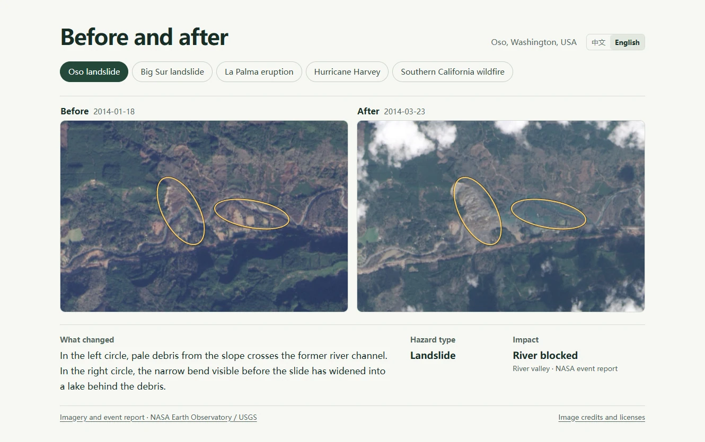

# Disaster Change Mapping and Building Damage Review

[简体中文](README.md) · **English**

Compare two images of the same place before and after a disaster. The circles show where to look. In the Oso landslide example, the left circle shows debris crossing the river. The right circle shows water spreading upstream.

[Open the live demo](https://zbw9654250-cmyk.github.io/disaster-change-review/?lang=en) · [Image credits](docs/DATA-NOTICE.en.md)



The demo has five cases. The three geological events have hand-drawn annotations and impact descriptions based on NASA and USGS reports. The other two cases show roofs before and after a hurricane and a wildfire. Their building damage grades come from xBD. Click either image to enlarge it. To use the demo offline, download and unzip the repository, then open [docs/index.html](docs/index.html).

## Run an example

Compare eight pairs of building images on a CPU. From the repository root, run these commands with Python 3.12.

```sh
python -m pip install -r modules/observations/requirements.txt
python modules/observations/run_roofs.py --cases data/xbd/confirm/cases.jsonl --output observations.jsonl
```

The script writes one line per building to `observations.jsonl`. The `explanation_zh` field describes changes in roof color or brightness in Chinese. The `evidence_region` field gives the location in each image. Use a new output filename when running the example again. [See sample output](results/observations/out/confirm-measure.jsonl)

## What the code does

| Task | What goes in and what comes out |
| --- | --- |
| [Locate roof damage](modules/roof_candidates/README.md) | Combine several model predictions and export roof holes and exposed roof decking as GeoJSON. |
| [Assess individual buildings](modules/buildings/README.md) | Crop an aerial image using building footprints and measure the damaged roof area. Optionally run Qwen3-VL for a preliminary building grade. |
| [Explain local changes](modules/observations/README.md) | Compare color and brightness on the same roof across two dates. Return a description with its location in both images. Qwen3-VL can also check the observations. |

Across five sites, both methods returned 1,269 candidates for review. Combining predictions increased correctly located damage features from 501 to 523 and reduced false positives from 768 to 746. In a separate test, the building grades matched xBD labels for 14 of 40 buildings, with 7 left ungraded. These grades need human review. [Evaluation details and results (Chinese)](results/README.md)

The project code uses the [MIT license](LICENSE). Images and models have their own terms. The xBD image crops require attribution, noncommercial use and sharing under the same license. [Data and model notices (Chinese)](NOTICE.md)
