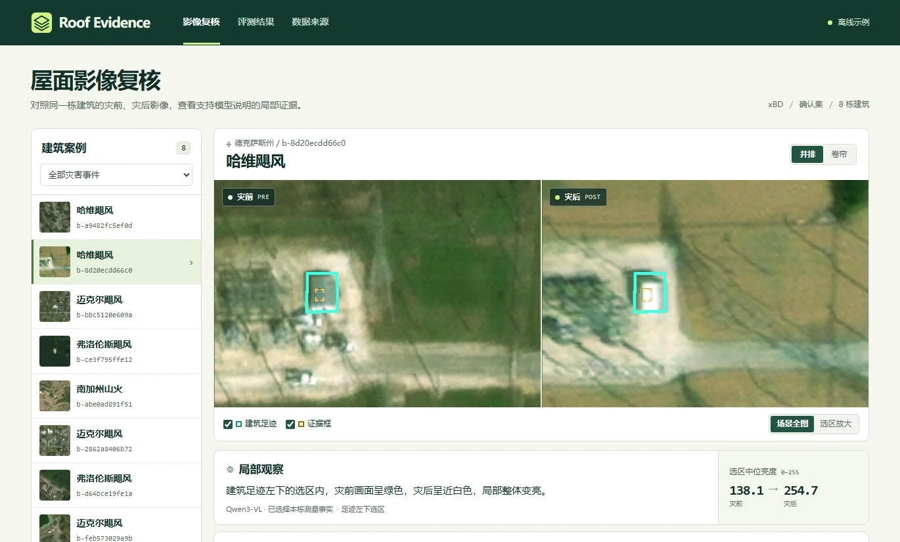

# Roof Evidence Review · 灾后屋面影像复核

面向灾后航拍与卫星影像的建筑复核工具。它把屋面孔洞和屋面板外露定位到地图上，按建筑汇总损伤，给出整栋初评，并把每条局部外观说明关联到可查看的影像区域。复核者可以在网页上来回比较同一栋建筑，判断文字里提到的变化能否在图中找到。



## 打开网页示例

下载并完整解压仓库，双击 [docs/index.html](docs/index.html)。选择奥索滑坡、大苏尔海岸滑坡、拉帕尔马火山、哈维飓风或南加州山火，即可并排看两期实图、拍摄日期和证据说明。两期影像用圈标出相应位置。点击照片可在新标签页放大查看带圈注的影像。全部案例都可离线打开。

滑坡和火山案例从 NASA 与 USGS 记录提取区域影响。两栋建筑的受灾程度用 xBD 原始标注，圈注标出本项目测量的屋面位置。地质灾害案例用于读图演示，未计入屋面或建筑模型的评测。[影像来源及口径](docs/DATA-NOTICE.md) · [模型评测记录](results/README.md)

也可以在仓库根目录启动静态服务，用浏览器打开 `http://127.0.0.1:8768/`。

```sh
python -m http.server 8768 --bind 127.0.0.1 --directory docs
```

## 从输入到结果

| 模块 | 输入 | 处理与输出 |
| --- | --- | --- |
| [屋面损伤定位](modules/roof_candidates/README.md) | 同一测区多组 Mask2Former 预测。另有从 RGB 正射图运行上游权重的入口 | 用几何重叠、面积和模型间的一致性对候选重排。在同等复核名额下输出孔洞与屋面板外露的 GeoJSON |
| [整栋损伤初评](modules/buildings/README.md) | 带坐标的灾后影像、建筑足迹、可选的损伤候选 | 按栋计算候选数量与覆盖率，裁出 RGB 原图及掩膜。可调用 Qwen3-VL 初评为无明显损伤、轻、中、重或待判，导出地图图层与复核页 |
| [局部证据与中文说明](modules/observations/README.md) | 同栋建筑的灾前后 RGB 裁图、足迹及可选的有效像素掩膜 | 对齐目标区域，测量局部亮度与颜色变化，输出中文观察、两期证据框和测量值。可用检索到的案例提示 Qwen3-VL 核验候选事实，按建筑 ID 和源图哈希挂接到整栋记录 |

网页中的局部说明回答“哪里发生了什么可见变化”。例如某块屋面由深色变为近白，可以在两期证据框内核对。整栋是否严重受灾要另看整栋初评、影像质量和人工意见。

## 用随附公开数据复跑

在仓库根目录、Python 3.12 环境下执行。局部测量、候选融合以及已保存评级的导出均可在 CPU 上运行。

```sh
python -m pip install -r requirements.txt
python modules/observations/run_roofs.py --cases data/xbd/confirm/cases.jsonl --output observations.jsonl
python modules/roof_candidates/apply_recall.py --strong data/roof_candidates/strong.geojson --same data/roof_candidates/same.geojson --dual data/roof_candidates/dual.geojson --mode equal_budget --output candidates.geojson
python modules/buildings/export_buildings.py --cases data/ebenezer/recorded/cases.jsonl --predictions data/ebenezer/recorded/grades.jsonl --out building-replay --credit "GlobalMedic / OpenAerialMap, CC BY 4.0"
python scripts/replay_results.py
```

第一条推理命令为 8 栋建筑各写一行 JSON，包含中文观察和证据框。第二条重放 Ebenezer 的 178 个候选，第三条使用存档模型输出生成 8 栋建筑的 GeoJSON 与 HTML。全量 GPU 推理所需的上游分割权重和 Qwen 权重按各模块说明另行获取。

## 已有结果

| 问题 | 数据与口径 | 结果 |
| --- | --- | --- |
| 相同人工复核量下，能多找到多少屋面损伤 | 5 个测区、880 个人工标注对象，固定 1,269 个预测，同类对象 IoU ≥ 0.50 | 正确定位 501 → 523，误报 768 → 746，对象级 F1 从 46.63% 升至 48.67% |
| 整栋四档初评有多准 | xBD 两批共 40 栋，对照官方等级 | 14/40 判对，7 栋待判，适合交给人工复查 |
| 局部说明能否在影像中核对 | 20 栋双期建筑，两名 AI 读者分别匿名评阅，两者均通过才计数 | 自由生成基线 1/20，CPU 测量和加 Qwen 核验均为 20/20。这个分数衡量说明与图像的对应关系 |

复现范围、受控光照实验、样本批次及逐例记录见[评测记录](results/README.md)。数据来源分为 [xBD 双期建筑](data/xbd/README.md)、[Ebenezer 公开航片](data/ebenezer/README.md)和[加勒比屋面预测图层](data/roof_candidates/README.md)。

## 测试与发布

在已安装 CPU 依赖的环境执行以下命令。发布检查会校验本地链接，并实际为 8 栋建筑生成观测结果。

```sh
python -m pip install pytest
python -m pytest -q modules
python scripts/check_release.py
```

将本仓库的 `main` 推送到自己的 GitHub 仓库后，提交和拉取请求会触发 [CPU 测试](.github/workflows/ci.yml)。发布网页时，在仓库的 **Settings → Pages → Build and deployment → Source** 选择 **GitHub Actions**，然后进入 **Actions → Publish demo to GitHub Pages → Run workflow**。部署完成后，工作流的 `github-pages` 环境会给出该仓库的实际网址。[网页发布工作流](.github/workflows/pages.yml) · [GitHub Pages 官方文档](https://docs.github.com/en/pages/getting-started-with-github-pages/using-custom-workflows-with-github-pages)

## 授权

项目代码采用 [MIT](LICENSE)。xBD 派生影像包含非商业使用与相同方式共享条件，加勒比屋面数据与 Ebenezer 航片保留各自署名。再分发或商用前请查看[第三方来源及许可](NOTICE.md)和[网页素材清单](docs/DATA-NOTICE.md)。
